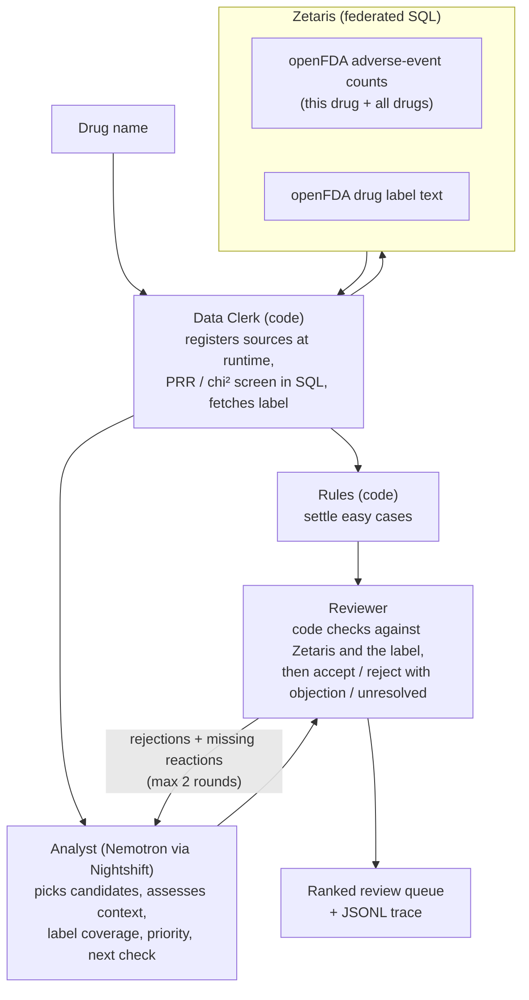

# Vigil: Drug Reaction Review

**AI agents that decide which reported drug reactions deserve a closer look, and explain why.**

Open Agent Hackathon 2026 · **Track 02: The Agent That Can Explain Why** · built on Zetaris, Meterless Nightshift and NVIDIA Nemotron

Vigil helps drug-safety analysts decide which reported drug-reaction patterns deserve a closer look. Every recommendation carries the numbers that triggered it, the label text it was checked against, the strongest objection to it, and a concrete next check.

> FAERS data shows reporting patterns, not that a drug causes an event. Vigil supports expert review; it is not medical advice.

---

## Why this matters

Drug-safety knowledge keeps changing after a medicine is approved, and every new signal has to be weighed by someone.

| | | |
|---|---|---|
| **23%** | **2 million+** | **~27,000 · 99.9%** |
| of 560 novel medicines approved 2001 to 2019 later received an FDA safety action (median follow-up 12 years) | adverse-event and medication-error reports evaluated each year by FDA's drug-safety office | statistical safety alerts in one company's year (GSK, 2023), and the share closed with a documented rationale |
| [Doernberg et al., *JAMA Intern Med* 2026](https://jamanetwork.com/journals/jamainternalmedicine/article-abstract/2842413) | [FDA Office of Surveillance and Epidemiology](https://www.fda.gov/about-fda/cder-offices-and-divisions/cder-office-surveillance-and-epidemiology) | [*Drug Safety* 2026, MLIT study](https://link.springer.com/article/10.1007/s40264-026-01696-0) |

These are three separate pieces of evidence, from different populations and years. They do not form a funnel, and none of them means that a quarter of medicines are unsafe or that the reports are confirmed injuries. Together they show three things:
- safety review after approval has consequential work to do
- the evidence arrives at scale
- generating an alert is the start of the work, not the end. Each one needs a decision, and the reason for it has to be written down.

## The user and the problem

**User:** a drug-safety (pharmacovigilance) analyst doing first-pass review of public reporting patterns, for example at a small biotech or a hospital pharmacy.

**Problem:** the analyst has to decide which reported drug-reaction patterns deserve further investigation, and assemble the evidence that makes each decision defensible. The hard part is the stretch between "this looks suspicious" and "here is a reasoned next step". For every candidate, the analyst asks:

1. **What triggered it?** The report counts and the disproportionality statistics.
2. **What does the label already say?** Whether the existing warnings describe it exactly, describe something broader or narrower, or say nothing.
3. **What weakens the first interpretation?** The drug's own indication, vague terms, data limits, competing explanations.
4. **What should happen next?** Investigate further, keep monitoring, or close it with a stated reason, for a human to decide.

Public data makes this harder, not easier. For montelukast (an asthma drug), the strongest statistical signals in FAERS are asthma, wheezing and airway obstruction: that's the disease the drug treats, not a side effect. Telling those apart from patterns worth a closer look is the judgement Vigil is built to support.

## What goes in, what comes out

**In:** a drug's generic name.

```json
{ "drug": "montelukast" }
```

**Out:** a **review queue** (the dossier), ranked so that "review next" comes first, plus a full trace of how it was produced.

| Every entry carries | Values |
|---|---|
| Report count and PRR, with the SQL that produced them | from Zetaris, re-checked by the Reviewer |
| `context`: what kind of term this is | clinical event · treated condition · non-clinical |
| `label_coverage`: does the current label already describe it? | covered · not found · unclear · not assessed |
| `label_quote`: the label sentence | extracted by code, never written by the model |
| `review_priority` | review next · insufficient evidence · lower priority |
| `strongest_objection` | the Reviewer's best argument against the finding as it stands |
| `next_check` | one concrete check that would settle or advance it |
| `workflow_status`: did the review finish, and how? | reviewed · unresolved · not reviewed · pending · failed |
| `history` | each round's claim, verdict and objection |

The dossier also reports **coverage**: how many reactions were screened, passed the statistical screen, were shown to the agents, assessed, reviewed, left unresolved or not reached. Nothing unfinished is presented as finished. The trace (`logs/trace-<run>.jsonl`) records every Zetaris query, every model call (including which model actually answered), and every agent message.

## Why this needs agents

The statistics don't need an LLM, and Vigil doesn't use one for them: disproportionality runs as SQL in Zetaris. Easy cases are settled by code rules: administrative terms, a reaction named in the indications, or a reaction named word for word in a warning. The model is used where judgement in language is needed:

- **Matching medical terms to label prose.** FAERS uses standard medical terms (MedDRA); labels use free text. "Nightmare" is covered by "sleep disturbances". "Productive cough" sits under "cough". "Full blood count abnormal" is broader than the label's "thrombocytopenia", so it is not covered. Keyword matching gets these wrong.
- **Telling the disease from the drug.** Wheezing for an asthma drug, or blood glucose for a diabetes drug, reflects the patients' illness. Deciding this needs knowledge of what the drug treats and what that condition looks like.
- **Choosing what deserves attention.** Montelukast alone has 256 reactions that pass the statistical screen. An analyst's time goes to the few that matter.
- **Arguing with itself.** A single model pass can't challenge its own first reading. Vigil has a second agent whose job is to object, and the first agent has to answer.

Code keeps the agents honest. The Reviewer's checks cannot be overruled by a model:
- every cited number is re-queried from Zetaris
- every cited query ID must exist
- every claimed label term must actually appear in the label
- "review next" is only allowed for an unlabelled clinical event that comes with a next check

## How it works



- **Data Clerk (code):** for any drug name, registers openFDA REST sources as Zetaris tables at runtime, computes the report-based 2×2 table (PRR, chi-squared, Evans screen) in SQL, and fetches the current label.
- **Analyst (Nemotron Ultra via Nightshift):** picks up to 10 of the 30 strongest signals, then assesses each one in small batches. It sees only the label sentences relevant to that reaction, plus the indication and the boxed warning.
- **Reviewer (code, then Nemotron Ultra):** runs the code checks first. It then accepts, rejects with an objection the Analyst must answer, or marks a finding unresolved when the evidence can't settle it. It also names important reactions nobody has looked at yet.
- **Loop:** at most 2 revision rounds. Accepted findings are never redone. If the agents go round in circles, or an objection is still standing when the rounds run out, the finding closes as **unresolved** rather than being accepted by default.
- **Resilience:** small parallel batches, retries, one-item-per-call fallbacks. Anything that still fails is reported as `failed` or `not_reviewed`, never guessed.

## How Vigil answers Track 02

> *Build agents that investigate complex questions across multiple data sources, connect findings, and produce evidence-backed answers or recommendations.*

| Track 02 asks for | In Vigil |
|---|---|
| **Investigate complex questions** | "Which of this drug's reported patterns deserve a closer look, and why?" There are hundreds of screen-positive reactions, each needing interpretation, not lookup |
| **Across multiple data sources** | Two openFDA datasets, adverse-event counts (this drug and the whole database) and drug labels, joined through Zetaris tables registered at runtime for any drug. Statistics and label prose are combined in one investigation. *(Planned: a reporter-type breakdown as a third evidence stream.)* |
| **Connect findings** | Each finding links its numbers, the matching label sentence, the Reviewer's objection and the Analyst's answer, round by round |
| **Evidence-backed answers or recommendations** | A ranked recommendation (review next / insufficient evidence / lower priority). Every number traces to a query ID and its SQL; every label quote is extracted by code; unresolved disputes are shown, not hidden |
| **Explain why** | `strongest_objection`, `next_check` and `history` say why each item sits where it does, and what would change it |

## Sponsor technology

- **Zetaris.** The data layer and where the statistics are computed. openFDA endpoints are registered as Zetaris REST tables **at runtime for whatever drug is asked about**, cached, flattened into views, and joined in SQL to produce the 2×2 disproportionality table. The Reviewer re-queries Zetaris to verify every number the Analyst cites. Without Zetaris there is no screen and no verification.
- **Meterless Nightshift.** The only model provider. Every agent call goes through Nightshift's OpenAI-compatible gateway with the required headers, and the trace records which model actually served each call. 
- **Meterless World Model engine.** `app/engines/world_model.py` is a Python port of the Meterless World Model reference (Apache-2.0): stable IDs, merge bands, provenance on every write, idempotent ingest, bitemporal edges and an ordered audit log, with the reference's eight conformance checks ported as tests. Vigil adds decisions that record the facts they rest on: each run stores the drug's label version and its settled verdicts, and when a later run sees a new label version, the earlier verdicts are reopened and listed in the dossier for a second look.
- **NVIDIA Nemotron.** Both agents run on `nvidia/nemotron-3-ultra-550b-a55b` through Nightshift.
- **Cursor.** Optional for this hackathon, and the team does not use it. Development is done with Claude Code.

## Results so far

A development evaluation against a reference set of 100 reactions across 5 drugs (montelukast, atorvastatin, metformin, sertraline, isotretinoin), run on 24 Oct with each drug once and montelukast twice more.
- **Accuracy:** 93% of the Analyst's first-round assessments (26 of 28) and 89% of final assessments (49 of 55) matched the reference label, among the clear reference items the agents assessed. Rules settled 27 of these, all correctly, and the model was right on 22 of 28.
- **The errors:** of the 6 final errors, 3 are reference rows written from older label versions whose wording today's labels no longer contain, 2 are judgement calls between a broader and a narrower term, and 1 is a model error (a contraindication counted as label coverage).
- **Coverage is the main gap:** the first round assessed 24 of the 80 clear reference items, and 43 had a final answer.
- **The Reviewer mostly confirmed:** it kept 26 correct findings and 2 wrong ones, and added 5 or 6 reactions per run that the Analyst had skipped.
- **Stable and faster:** three montelukast runs agreed on 95% of the reactions they shared, and each run took 8 to 11 minutes.

These are **development checks, not clinical validation**. The reference labels were drafted by an AI assistant from the label text and are pending review by a person ([eval/LABELLING_RULES.md](eval/LABELLING_RULES.md)), and none of us is a pharmacovigilance professional. We have not measured time saved or decision quality against a human baseline. Full report: [eval/reports/eval-20261024T022640Z.md](eval/reports/eval-20261024T022640Z.md).

## Status

| Built | Next |
|---|---|
| Zetaris data layer for any drug; SQL statistics, verified against an independent calculation | Live evaluation of the current decision contract (implemented and unit-tested) |
| Analyst and Reviewer loop with code checks, objections, unresolved disputes and fallbacks | A live run that shows a label change reopening earlier verdicts (shown offline so far) |
| Meterless World Model engine: label versions and verdicts kept across runs, with conformance tests | |
| Ranked review queue with coverage counts; JSONL traces | A Skeptic step: reporter-type evidence for top candidates |
| Evaluation harness (gold set, scorer, repeat-run agreement) | One-page investigation view, `POST /run`, Dockerfile, sample mode |

## Run it

Needs Python 3.11+, plus a local Zetaris and Meterless Nightshift; the hackathon requires both to run on your own machine. Full setup: [docs/TEAM_SETUP.md](docs/TEAM_SETUP.md).

```bash
python -m pip install -r requirements.txt
```

```bash
python -I -m pytest tests -q
```

The offline tests need no services.

```bash
cp .env.example .env
```

Fill in the Zetaris and Nightshift values. The NVIDIA key goes into Nightshift, not `.env`.

```bash
python -I scripts/zetaris/run_sql.py scripts/zetaris/openfda_baseline.sql
```

This registers the shared Zetaris baseline, once per Zetaris install.

```bash
python -I run.py --drug montelukast
```

Results: `logs/dossier-<run>.json` (the review queue) and `logs/trace-<run>.jsonl` (every query and model call).

## Limitations

- **FAERS** reports are voluntary and unverified, can be duplicated, and show association, not causation. Screen-positive means "worth a look", not new or proven.
- **We count every report that mentions the drug,** including reports where it was not the suspect drug. This broadens the population; it does not necessarily inflate the PRR.
- **Coverage limits:**
  - The baseline holds the 999 most-reported reactions (openFDA's limit without a key).
  - The Analyst assesses a limited number of candidates per run.
  - Both limits are shown in the coverage counts.
- **Aggregate data only:** no case-level review and no duplicate removal. Breakdowns such as reporter type give context, not adjustment for confounding.
- **Labels:** the label is the latest prescription label filed under the drug's most common single-ingredient generic name, one manufacturer's version among many. If no single-ingredient name is found, it falls back to the first label openFDA returns, which can be a combination product.
- **Nightshift memory:** Nightshift's H-MEM adds earlier answers to a prompt after the app sends it, and the model treated them as vetted, which repeated one wrong answer across runs. The app keeps it out by sending a fresh `meterless-scope` on every call, because Nightshift walls its memory by scope. The World Model is the app's memory of past decisions instead. Each model call's trace event records how many memories were injected (from Nightshift's own receipt), and the dossier counts them under `model_calls`, so a run shows it was none.
- **Shared model:** the Analyst and Reviewer use the same model, so their agreement is not independent corroboration. The code checks are the independent part.

## Data and privacy

All data is public: openFDA adverse-event aggregates and drug labels. No case-level or personal data reaches the app or the model. Secrets live only in `.env`, which is gitignored.

## More

Named **Black Box** until 23 Oct 2026, with agents called Clerk, Hunter and Judge (now Data Clerk, Analyst and Reviewer). Traces and evaluation reports from before the rename keep the old names.


- [docs/HANDOFF.md](docs/HANDOFF.md): current state, code map, next steps
- [docs/ideas/VIGIL.md](docs/ideas/VIGIL.md): design and the reasons behind it
- [docs/TEAM_SETUP.md](docs/TEAM_SETUP.md): teammate setup
- [AGENTS.md](AGENTS.md): rules for coding agents
- [eval/](eval/): gold set, labelling rules, scorer, reports
- [docs/PREEXISTING.md](docs/PREEXISTING.md): pre-existing work declaration
