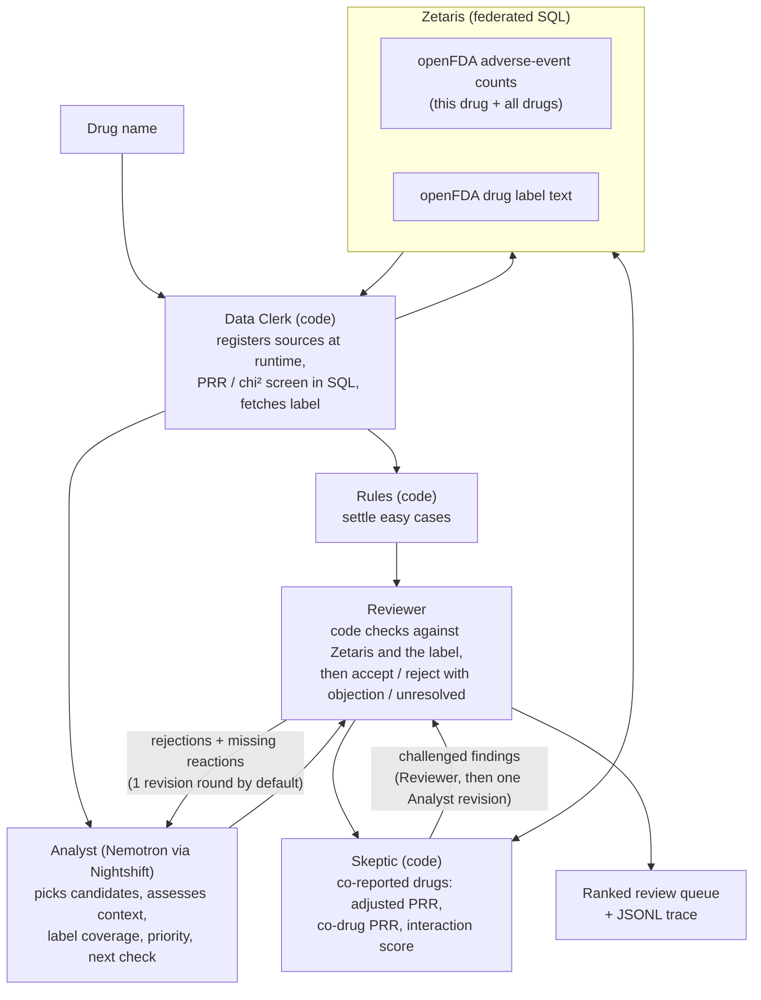

# Vigil: Drug Reaction Review

**AI agents that decide which reported drug reactions deserve a closer look, and explain why.**

Open Agent Hackathon 2026 · **Track 02: The Agent That Can Explain Why** · built on Zetaris, Meterless Nightshift and NVIDIA Nemotron

Vigil helps drug-safety analysts decide which reported drug-reaction patterns deserve a closer look. Every recommendation carries the numbers that triggered it, the label text it was checked against, the strongest objection to it, and a concrete next check.

> FAERS data shows reporting patterns, not that a drug causes an event. Vigil supports expert review; it is not medical advice.

---

## Why this matters

Drug-safety knowledge keeps changing after a medicine is approved, and every new signal has to be weighed by someone.

| | | |
|---|---|---|
| **23%** | **2 million+** | **~27,000 · 99.9%** |
| of 560 novel medicines approved 2001 to 2019 later received an FDA safety action (median follow-up 12 years) | adverse-event and medication-error reports evaluated each year by FDA's drug-safety office | statistical safety alerts in one company's year (GSK, 2023), and the share closed with a documented rationale |
| [Doernberg et al., *JAMA Intern Med* 2026](https://jamanetwork.com/journals/jamainternalmedicine/article-abstract/2842413) | [FDA Office of Surveillance and Epidemiology](https://www.fda.gov/about-fda/cder-offices-and-divisions/cder-office-surveillance-and-epidemiology) | [*Drug Safety* 2026, MLIT study](https://link.springer.com/article/10.1007/s40264-026-01696-0) |

These are three separate pieces of evidence, from different populations and years. They do not form a funnel, and none of them means that a quarter of medicines are unsafe or that the reports are confirmed injuries. Together they show three things:
- safety review after approval has consequential work to do
- the evidence arrives at scale
- generating an alert is the start of the work, not the end. Each one needs a decision, and the reason for it has to be written down.

## The user and the problem

**User:** a drug-safety (pharmacovigilance) analyst doing first-pass review of public reporting patterns, for example at a small biotech or a hospital pharmacy.

**Problem:** the analyst has to decide which reported drug-reaction patterns deserve further investigation, and assemble the evidence that makes each decision defensible. The hard part is the stretch between "this looks suspicious" and "here is a reasoned next step". For every candidate, the analyst asks:

1. **What triggered it?** The report counts and the disproportionality statistics.
2. **What does the label already say?** Whether the existing warnings describe it exactly, describe something broader or narrower, or say nothing.
3. **What weakens the first interpretation?** The drug's own indication, vague terms, data limits, competing explanations.
4. **What should happen next?** Investigate further, keep monitoring, or close it with a stated reason, for a human to decide.

Public data makes this harder, not easier. For montelukast (an asthma drug), the strongest statistical signals in FAERS are asthma, wheezing and airway obstruction: that's the disease the drug treats, not a side effect. Telling those apart from patterns worth a closer look is the judgement Vigil is built to support.

## What goes in, what comes out

**In:** a drug's generic name.

```json
{ "drug": "montelukast" }
```

**Out:** a **review queue** (the dossier), ranked so that "review next" comes first, plus a full trace of how it was produced.

| Every entry carries | Values |
|---|---|
| Report count and PRR, with the SQL that produced them | from Zetaris, re-checked by the Reviewer |
| `context`: what kind of term this is | clinical event · treated condition · non-clinical |
| `label_coverage`: does the current label already describe it? | covered · not found · unclear · not assessed |
| `label_quote`: the label sentence | extracted by code, never written by the model |
| `review_priority` | review next · insufficient evidence · lower priority |
| `strongest_objection` | the Reviewer's best argument against the finding as it stands |
| `next_check` | one concrete check that would settle or advance it |
| `workflow_status`: did the review finish, and how? | reviewed · unresolved · not reviewed · pending · failed |
| `history` | each round's claim, verdict and objection |
| `label_search`, where the label names the reaction | every fetched section searched in code before any model call, with which sections can support coverage |
| `uncertainty`, how thin the evidence is | expected count, PRR 95% interval, IC025 and a thin-evidence mark, worked out in code |
| `report_sources` (review-next entries only) | country and reporter-type flags against the drug's usual mix, as context, never a reason to reject |
| `manual_review`, whether a person should look first | a flag with its reasons, which changes no status, priority or ranking |

The dossier also reports **coverage**: how many reactions were screened, passed the statistical screen, were shown to the agents, assessed, reviewed, left unresolved or not reached. "Reviewed" means the Reviewer model accepted the finding, not that a safety professional checked it. The trace (`logs/trace-<run>.jsonl`) records every Zetaris query, every model call (including which model actually answered), and every agent message.

Two parts of the dossier sit outside the queue. `data.scope` names both 999-reaction caps and their cutoffs, so a reader can see what the screen can't reach. The **serious-term safety net** (`safety_net`) lists, for a person to review, EMA's designated medical events, terms outside the screen with more than half of their reports flagged serious, and pregnancy and newborn terms, with no cap. It opens with a summary line. In each section the terms the label search doesn't find by name come first, then those named only outside effect text (such as a contraindication), then those the effect text covers, each by serious reports. Every row has its serious reports and share, its label status, a designated medical event flag and a thin mark under 3 reports. Nothing in the safety net reaches an agent, the queue or its ranking.

## Why this needs agents

The statistics don't need an LLM, and Vigil doesn't use one for them: disproportionality runs as SQL in Zetaris. Easy cases are settled by code rules: administrative terms, a reaction named in the indications, or a reaction named word for word in a warning. The model is used where judgement in language is needed:

- **Matching medical terms to label prose.** FAERS uses standard medical terms (MedDRA); labels use free text. "Nightmare" is covered by "sleep disturbances". "Productive cough" sits under "cough". "Full blood count abnormal" is broader than the label's "thrombocytopenia", so it is not covered. Keyword matching gets these wrong.
- **Telling the disease from the drug.** Wheezing for an asthma drug, or blood glucose for a diabetes drug, reflects the patients' illness. Deciding this needs knowledge of what the drug treats and what that condition looks like.
- **Choosing what deserves attention.** Montelukast alone has 256 reactions that pass the statistical screen. Vigil orders them by reporting strength and label status so an analyst can start at the top. It does not yet weigh seriousness, outcome or vulnerable groups.
- **Arguing with itself.** A single model pass can't challenge its own first reading. Vigil has a second agent whose job is to object, and the first agent has to answer.

Code keeps the agents honest. The Reviewer's checks cannot be overruled by a model:
- the report count and PRR each finding cites are re-queried from Zetaris
- at least one cited query ID must exist
- every claimed label term must actually appear in the label
- "review next" is only allowed for an unlabelled clinical event that comes with a next check

Numbers written into free text, such as the reasoning, are not checked.

## How it works



- **Data Clerk (code):** for any drug name, registers openFDA REST sources as Zetaris tables at runtime, computes the report-based 2×2 table (PRR, chi-squared, Evans screen) in SQL, and fetches the current label.
- **Analyst (Nemotron Ultra via Nightshift):** always assesses the 15 strongest signals by chi-squared and may add up to 5 more of its own choice from the next 15, then assesses each one in its own call. It sees only the label sentences relevant to that reaction, plus the indication and the boxed warning.
- **Reviewer (code, then Nemotron Ultra):** runs the code checks first. It then accepts, rejects with an objection the Analyst must answer, or marks a finding unresolved when the evidence can't settle it. It also names up to 3 unassessed reactions that it expects a reviewer to want to see.
- **Skeptic (code, Zetaris counts):** takes the strongest accepted "review next" findings (top 3 by chi²) and checks them against the drugs most often reported alongside them (top 3, salts merged). For each co-drug it asks whether the reaction is disproportionate for the co-drug itself, whether this drug's PRR stays at 2 or above once the co-drug is adjusted for (Mantel-Haenszel over reports with and without it), and whether reports naming both drugs show more of the reaction than either alone predicts (the Omega interaction measure, Norén et al., *Statistics in Medicine* 2008). A finding is challenged only when the adjusted PRR falls below 2 for some co-drug; the co-drug's own signal and the interaction score are shown as context, because in our test runs neither separated real signals from the patients' shared conditions. A challenged finding goes back to the Reviewer with these numbers; if the Reviewer rejects it, the Analyst gets one revision and the Reviewer a final look. The Skeptic never changes a priority itself.
- **Loop:** one revision round by default (`REVIEWER_ROUNDS`), inside a 10-minute run budget (`RUN_BUDGET_SECONDS`) that skips later steps when time runs out and records what it skipped. Accepted findings are never redone. If the agents go round in circles, or an objection is still standing when the rounds run out, the finding closes as **unresolved** rather than being accepted by default.
- **Resilience:** parallel one-reaction calls, streamed replies, retries and a shared pause on rate limits. Anything that still fails is reported as `failed` or `not_reviewed`, never guessed.

## How Vigil answers Track 02

> *Build agents that investigate complex questions across multiple data sources, connect findings, and produce evidence-backed answers or recommendations.*

| Track 02 asks for | In Vigil |
|---|---|
| **Investigate complex questions** | "Which of this drug's reported patterns deserve a closer look, and why?" There are hundreds of screen-positive reactions, each needing interpretation, not lookup |
| **Across multiple data sources** | Two openFDA datasets, adverse-event counts (this drug and the whole database) and drug labels, joined through Zetaris tables registered at runtime for any drug. Statistics and label prose are combined in one investigation. A third stream, the co-reported drugs on each top finding's reports, is queried through Zetaris for the Skeptic. |
| **Connect findings** | Each finding links its numbers, the matching label sentence, the Reviewer's objection and the Analyst's answer, round by round |
| **Evidence-backed answers or recommendations** | A ranked recommendation (review next / insufficient evidence / lower priority). Every number in the structured fields traces to a query ID and its SQL; every label quote is extracted by code; unresolved disputes are shown, not hidden |
| **Explain why** | `strongest_objection`, `next_check` and `history` say why each item sits where it does, and what would change it |

## Sponsor technology

- **Zetaris.** The data layer and where the statistics are computed. openFDA endpoints are registered as Zetaris REST tables **at runtime for whatever drug is asked about**, cached, flattened into views, and joined in SQL to produce the 2×2 disproportionality table. The Reviewer re-queries Zetaris to verify every number the Analyst cites. Without Zetaris there is no screen and no verification.
- **Meterless Nightshift.** The only model provider. Every agent call goes through Nightshift's OpenAI-compatible gateway with the required headers, and the trace records which model actually served each call. 
- **Meterless World Model engine.** `app/engines/world_model.py` is a Python port of the Meterless World Model reference (Apache-2.0): stable IDs, merge bands, provenance on every write, idempotent ingest, bitemporal edges and an ordered audit log, with the reference's eight conformance checks ported as tests. Vigil adds decisions that record the facts they rest on: each run stores the drug's label version and its settled verdicts, and when a later run sees a new label version, the earlier verdicts are reopened and listed in the dossier for a second look. Every run also reads the World Model back: each dossier item gets `since_last_run`, which compares its verdict with the one the engine holds from earlier runs of the drug (new, unchanged, changed or not settled now, with the fields that changed and why: a new label version, different report counts, or the agents' judgement on the same evidence). The run summary also lists reactions an earlier run sent to review next that this run did not assess, and the trace keeps the engine's audit entries for the run. On real montelukast runs of 25 Oct this showed 19 verdicts unchanged and 3 changed between runs on the same label, which is the run-to-run variation one run per drug cannot otherwise show. The agents' prompts never read the World Model: a past answer shown to the model is read as evidence, which is what Nightshift's H-MEM replay did on 23 and 24 Oct. Each dossier says this under `world_model.read_by`.
- **NVIDIA Nemotron.** Both agents run on `nvidia/nemotron-3-ultra-550b-a55b` through Nightshift.
- **Cursor.** Optional for this hackathon, and the team does not use it. Development is done with Claude Code.

## Results so far

On 25 and 26 Oct each version was re-run on its own code defaults, the settings a teammate gets from [docs/TEAM_SETUP.md](docs/TEAM_SETUP.md). That's Ultra for both agents, 4 model calls at a time, 1 revision round, a 600 s budget, a 90 s call limit and 1 retry, with no `.env` setting beyond the connection keys. Runs went one at a time on the same machine. Where two versions ran on the same drug, they ran one after the other, in random order for most pairs and a fixed order for the rest (both recorded in the summary). One scorer (`eval/score.py` on `main`) scored every dossier for the five reference drugs against gold v2, a reference set of 100 reactions drafted by an AI assistant from the current label text. No person has reviewed it yet, and its ambiguous rows are left out of the scores. Intervals are Wilson 95%, and paired comparisons use an exact McNemar test on the clear items both runs answered. The method, every run and its trace checks are in [eval/reports/reeval-25oct-summary.md](eval/reports/reeval-25oct-summary.md).
- **The final version.** The version in this branch (`8ae141c`, with task 2, the speed-ups, the messy-input stops and the Skeptic fix) ran once on three gold v2 drugs (metformin, sertraline and isotretinoin) and the three newer drugs, each paired with `main` run in the same hour. Its code, as `b7868b8`, also ran on atorvastatin and montelukast in the Skeptic-fix test below, against a different control. The pairs were needed because NVIDIA served the overnight runs about 30% slower than the previous evening (a median of 38 against 54 tokens/s, 33 to 48 overnight), and no pair differed by more than 15%. Over the six pairs, final answers agreed with the reference on 78 of 80 clear items (95% interval 91 to 99%) for the final version and 74 of 77 (89 to 99%) for `main`, and the final version answered 80 of the 110 clear items against 77. On the 73 items both answered, the final version alone was right on 2 (zuranolone's mania and panic attack, which its label names only in the Medication Guide) and `main` alone on 1 (empagliflozin's impaired gastric emptying), exact McNemar p = 1.0. It surfaced 14 of the newer drugs' 15 serious reactions hidden by the screen's caps, against none. On sotagliflozin's thin rows its explanations used words of caution on 8 of 11 items against 2 of 9, by task 3's measure, and it moved renal pain and micturition urgency (4 reports each) from review next, where `main` kept them, to insufficient evidence. It left 4 items unresolved and none failed, against 8 and 3. Its median run took 554 s (482 to 715 s) against 608 s (540 to 757 s), with a median of 41 s outside model calls against 143 s. Two of its six runs and three of `main`'s ended past the 600 s budget. Its one weakness was 7 Reviewer batches lost to NVIDIA timeouts against 4, which one pair per drug can't attribute. The Skeptic raised one challenge per version (on empagliflozin), which the final version reviewed and `main` skipped for time.

Each part was tested on its own first.
- **Ricky's pre-push code against `main`.** Ricky's branch before our pushes (`083b669`) and `main` (`53d100d`, with PR #10 and PR #11) ran once on each of the five gold v2 drugs (montelukast, atorvastatin, metformin, sertraline, isotretinoin). Final answers agreed with the reference on 49 of 51 (95% interval 87 to 99%) clear items before and 59 of 60 (95% interval 91 to 100%) after. First-round answers agreed on 55 of 58 (95% interval 86 to 98%) and 57 of 58 (95% interval 91 to 100%). On the 57 clear items both versions answered in round 1, `main` was right where the older code was wrong on 2 and never the reverse (exact McNemar p = 0.5). On the 49 shared final answers it was 1 against 0 (p = 1.0). Runs took median 636 s (558 to 660 s) before and median 616 s (567 to 652 s) after. So PR #10 and PR #11 made no measurable difference to accuracy. What they changed is completeness. `main` answered 9 more clear items (60 of 71 against 51), left 3 items unresolved, not reviewed or failed against 20, had no calls cut at 45 s against 18, and fitted its revision round in 4 of 5 runs against 1. Six clear items never reach the queue in either version, so part of the remaining gap is the screen and selection, not the review.
- **Task 2 against `main`.** Task 2 (`13421ee`) adds the label search, report sources, uncertainty marks, the safety net, rule fixes and the manual-review flag. It ran once on the same five drugs. Final answers agreed on 56 of 57 (95% interval 91 to 100%) clear items, against 59 of 60 (95% interval 91 to 100%) on `main`, and first-round answers on 56 of 57 (91 to 100%), against 57 of 58 (95% interval 91 to 100%). Task 2 and `main` gave the same answer on all 57 clear items both answered, so the paired test has nothing to compare. Runs took median 593 s (518 to 674 s). So task 2 leaves accuracy on these label lookups unchanged. Its prompts are about 30 to 40% longer, because the label search adds what it found, and its calls took about 2.5 s more each. That likely contributes to the revision round fitting in 2 of 5 runs against 4, though one run per drug can't separate it from NVIDIA's varying speed, and it answered 3 fewer clear items (57 against 60). One was left pending when the budget skipped the revision round, one the Reviewer didn't name as missing, and one was lost to a first-byte timeout. Its background checks (safety net and report sources) finished well before they were needed and cost no budget. Its later commits, to `65d7c50`, change only the safety net's display, which feeds no prompt.
- **The combined build.** The speed-ups on top of task 2 (`484beba`) ran once each on montelukast and sertraline, against task 2's runs of the same drugs. Runs took 590 s on montelukast and 350 s on sertraline, against 593 s and 518 s. Time outside model calls was 99 s and 40 s, against 166 s and 117 s, which is the fairer measure, as NVIDIA's speed varied from 42 to 69 tokens/s across the night's runs. Final answers agreed on 24 of 24 clear items, against 23 of 23. The full pipeline fitted the budget in both runs. On montelukast that included the Skeptic's challenge review and its revision, the only run of all 23 that night with every step. Both runs also happened to get no NVIDIA rate-limit waits (task 2's had 13 and 10), which flatters the totals. On montelukast the extra parallel Zetaris work, up to 9 queries at once against 5, set off two openFDA HTTP 500 errors, the first reading "Too Many Requests" (the second's text was cut off in the trace). The Reviewer re-ran its failed re-check successfully. The failed Skeptic query was lost, but it was an early guess at a target that turned out not to need checking, so no output changed. Still, a cap on simultaneous Zetaris queries would be safer.
- **Three newer drugs.** `main` and task 2 ran once each on zuranolone, sotagliflozin and empagliflozin. Newer drugs have fewer reports and less label history, so they test what the screen and the label search do with thin data. They were scored against a separate reference for these drugs ([eval/gold_newdrugs_v1.jsonl](eval/gold_newdrugs_v1.jsonl), 217 rows drafted by an AI assistant, labelled twice blind (kappa 0.946) and frozen before the runs, see [eval/GOLD_NEWDRUGS_V1.md](eval/GOLD_NEWDRUGS_V1.md)). Final answers agreed on 39 of 43 (95% interval 78 to 96%) on `main` and 40 of 42 (84 to 99%) with task 2. Runs took median 584 s (549 to 644 s) and median 572 s (568 to 694 s). Task 2's safety net surfaced 14 of the reference's 15 serious reactions hidden by the screen's caps, against none on `main`, including empagliflozin's Fournier's gangrene and euglycaemic ketoacidosis. In round 1 task 2 was right on 3 items where `main` was wrong and never the reverse (39 of 42 against 36 of 42, exact McNemar p = 0.25). Two were zuranolone's mania and panic attack, which its label names only in the Medication Guide. On sotagliflozin's thin rows, by task 3's measure, task 2's explanations used words of caution on 4 of 8 thin items and `main`'s on 4 of 11, about level, once phrases like "not thin" are left out. In the Analyst's reasoning alone it was 3 against 0. It moved two 4-report items from review next to insufficient evidence, and neither version overstated a thin item. It answered one fewer clear item overall (42 against 43). It left 2 sotagliflozin items pending when its revision round was skipped for time, and answered one more on empagliflozin (lactic acidosis, which `main` left unresolved). The safety-net lists are long (86 to 285 terms on these drugs, and 320 to 480 on the gold v2 drugs) and nothing classifies them, so a person still has to read them. The summary line and the order (unlabelled serious terms first) are there to make that quicker.
- **The Skeptic fix.** With the challenge review moved into the Reviewer's first round (`b7868b8`), the Skeptic's 3 challenges on atorvastatin were all reviewed, against none for the combined build at the same NVIDIA speed (about 38 tokens/s), 79 minutes apart. Montelukast's one challenge was reviewed in both. The reviews changed 2 of the Analyst's claims within the run (one priority, one label-coverage call). Of the challenged items, one recommendation differs against the build without the fix. Chronic kidney disease moved from review next to insufficient evidence, because co-prescribed proton-pump inhibitors (omeprazole, pantoprazole and esomeprazole) weaken its signal. Model calls stayed within 4 at a time. Every shared clear item was right in both versions, and the fixed version answered one more on atorvastatin. Both runs ended 55 s past the 600 s budget. On atorvastatin the last challenge review started with 121 s left and ran to its end. On montelukast three calls hit the 90 s limit in the revision round. Three Reviewer batches failed on NVIDIA timeouts and left 3 items not reviewed, against none in the control. Nothing in the traces points to the challenge review, but one pair per drug can't rule out that its extra calls added load.
- **What the reference scores.** Gold v2's clear items are mostly label lookups, such as whether a reaction is on the label or is the treated disease. On `main` the first round answered 58 of the 71 clear items. The review-next list, the main output, is barely scored. Of `main`'s 22 review-next entries, 20 are rows the reference calls ambiguous or doesn't include.
- **Model calls.** Across all 23 runs on 25 Oct, all 808 successful calls were served by Nemotron Ultra, with no reasoning scaffold. Nightshift's H-MEM injected 472 earlier answers into the 160 calls of Ricky's pre-push code, which used a shared memory scope, and none into the other 648. There were 282 NVIDIA rate-limit waits (5,790 s of pauses in all), 32 first-byte timeouts and 10 calls cut at the 90 s limit. The 18 calls cut at Nightshift's 45 s deadline were all in the pre-push code. In the twelve paired runs on 26 Oct every call was served by Nemotron Ultra, with no reasoning scaffold, no H-MEM and no NVIDIA rate-limit waits. NVIDIA's slow overnight speed showed instead as 54 first-byte timeouts and 25 calls cut at the 90 s limit (26 and 13 for `main`, 28 and 12 for the final version).
- **What one run per drug can't show.** Every comparison is between single runs, and Nemotron's answers vary between runs, so a difference of one or two items on a drug may be noise. There's no repeat run to measure that noise, and the McNemar test treats items as independent, so it doesn't capture run-to-run variation. A p-value above 0.05 isn't evidence either way. `083b669` against `main` measures PR #10 and PR #11 together, so it can't say which one made a difference. Task 2's runs came after `main`'s rather than between them, so their run times are the weaker comparison. The speed-ups ran on two drugs only, and two runs can't show a general speed-up. The final version's pairs ran overnight, when NVIDIA served calls about 30% slower than the previous evening, so both versions lost items to timeouts that a faster hour would not have cost. The pairs are fair to each other, but their absolute coverage and run times are pessimistic.

An earlier evaluation on 24 Oct agreed on 58 of 58 final clear items, but it was measured with a developer's `.env` (2 model calls at a time and 2 revision rounds, not the defaults), so this re-run supersedes it ([eval/reports/eval-20261024T125052Z-gold_v2.md](eval/reports/eval-20261024T125052Z-gold_v2.md)).

These are **development checks, not clinical validation**. None of us is a pharmacovigilance professional, and the reference set is AI-drafted ([eval/LABELLING_RULES.md](eval/LABELLING_RULES.md)). We have not measured time saved or decision quality against a human baseline. All reports: [eval/reports/](eval/reports/).

## Status

| Built | Next |
|---|---|
| Zetaris data layer for any drug; SQL statistics, verified against an independent calculation | A held-out evaluation, and a person's review of the reference sets |
| Analyst and Reviewer loop with code checks, objections, unresolved disputes and fallbacks | A live run that shows a label change reopening earlier verdicts (shown offline so far) |
| Meterless World Model engine: label versions and verdicts kept across runs, with conformance tests | |
| Ranked review queue with coverage counts; JSONL traces | Report sources as a Skeptic check (today they are context for the Reviewer) |
| Label search across every fetched section, report sources, uncertainty marks, the manual-review flag and the serious-term safety net (25 Oct) | A broader-term match for the label search |
| Skeptic: co-reported drug check (adjusted PRR, co-drug PRR, Omega interaction) for the top findings | |
| Evaluation harness (gold set, scorer, repeat-run agreement) | One-page investigation view, sample mode |
| `POST /run` API with structured errors; Dockerfile | |
| Plain early stops for unknown, misspelt, brand-only and label-less drug names, before any model call (26 Oct) | |

## Not in this version

We left these out before the 26 Oct freeze. Each is a known gap, stated here so it isn't mistaken for a hidden one.

- **A faster model for some roles.** Both agents use Nemotron Ultra. We didn't test giving the Analyst's first pass to Nemotron Super, because Nightshift 1.2.1 doesn't honour a model pin, so two models can't yet be routed reliably.
- **Control over how long the model thinks.** No setting reaches Ultra's reasoning through Nightshift, and a prompt asking for shorter reasoning wasn't tested because it could cost accuracy.
- **The World Model in the agents' prompts.** Code reads the World Model in every run (`since_last_run`), but the agents don't, on purpose: earlier verdicts would anchor the model. Reopening after a label change was seen live on 23 Oct, when Vigil's own label choice changed the label document, not after an FDA revision.
- **Broader-term label matching.** The label search matches a reaction's name, set synonyms and simple changes. A broader label term, such as "diabetic ketoacidosis" for euglycaemic diabetic ketoacidosis, isn't recognised as coverage.
- **An "expected pharmacology" category.** A reaction the label names only in its pharmacology is marked "unclear".
- **The brand holder's label.** Vigil takes the newest single-ingredient prescription label, which can be a repackager's copy.
- **Brand and salt names.** Vigil searches by generic name. A brand name stops with a pointer to its generic, and a salt form runs but finds fewer reports than the base name (17% fewer for metformin hydrochloride than metformin), with no warning.
- **A backtest of early detection.** openFDA keeps only the latest version of each case, so the past can't be rebuilt, and we make no early-detection claim.
- **Case-level review.** Vigil works on aggregate counts, with no duplicate removal or narrative review.
- **A human-reviewed reference set and a held-out evaluation.** Both reference sets were drafted by an AI assistant and haven't been reviewed by a pharmacovigilance professional. All scores are one run per drug, on drugs used while building Vigil.
- **Higher rate limits.** Runs use openFDA without a key and an NVIDIA trial key, so rate limits shape run time.

## Run it

Needs Python 3.11+, plus a local Zetaris and Meterless Nightshift; the hackathon requires both to run on your own machine. Full setup: [docs/TEAM_SETUP.md](docs/TEAM_SETUP.md).

```bash
python -m pip install -r requirements.txt
```

```bash
python -I -m pytest tests -q
```

The offline tests need no services.

```bash
cp .env.example .env
```

Fill in the Zetaris and Nightshift values. The NVIDIA key goes into Nightshift, not `.env`.

Set up Nightshift before the first run. Vigil was tested on Windows with Nightshift 1.2.1 and 1.2.7. Nightshift 1.2.1 ignores the model an app asks for and routes each call by its own settings (not yet checked on 1.2.7), so leave it only the model Vigil uses.
- one lane running `nvidia/nemotron-3-ultra-550b-a55b`, with every other lane stopped
- Setup › Preferences › race width 1
- Setup › Preferences › Quality track: answer fusion, answer judging, best-of-N, the quality race and the reasoning scaffold all off. Leave the cloud first-token limit at 45 s and NVIDIA thinking at default. Then restart Nightshift.

The 1.2.7 settings page can show its own defaults (race width 6, the Quality track options on auto) instead of the saved settings, so set these values once by hand, even if they were set before an update.

Without these, calls can go to other models, and about half are answered unstreamed and cut off at 45 s. Each run checks this and warns, in the console and in the dossier's `nightshift_warnings`, when a call was served by another model or with the scaffold on.

```bash
python -I scripts/zetaris/run_sql.py scripts/zetaris/openfda_baseline.sql
```

This registers the shared Zetaris baseline, once per Zetaris install.

```bash
python -I run.py --drug montelukast
```

Results: `logs/dossier-<run>.json` (the review queue) and `logs/trace-<run>.jsonl` (every query and model call).

### As an API

```bash
python -I run.py
```

With no arguments `run.py` starts the API on port 8000 (`PORT` or `--port` to change it). A run takes several minutes and handles one investigation at a time, because parallel runs share the NVIDIA per-minute cap.

```bash
curl -X POST http://localhost:8000/run -H "Content-Type: application/json" -d @input_examples/example_1.json
```

- `POST /run` takes `{"drug": "montelukast"}` or `{"run_id": "demo-001", "input": {"drug": "montelukast"}, "options": {"wait": true}}`. It answers when the run ends with `status`, `output` (summary, accepted review-next items, unresolved items, the full dossier), the agents, the models, `trace_id`, `log_file` and `execution_time_seconds`.
- With `"options": {"wait": false}` it answers `202` at once; `GET /runs/<run_id>` then reports `running` or the finished result.
- Failures come back as `{"status": "error", "error": {"type", "message", "recoverable"}}`: `InvalidInput` (400), `DrugNotFound` (404), `Busy` or `RunIdInUse` (409), `ZetarisUnavailable`, `NightshiftUnavailable` or `NightshiftUnauthorized` (502), `SampleModeNotImplemented` (501). The trace records the error too.
- `GET /health` shows the configured models and service addresses (never keys) and whether a run is in progress.

### With Docker

```bash
docker build -t vigil .
```

```bash
docker run --rm -p 8000:8000 --env-file .env -v "$(pwd)/logs:/app/logs" -v "$(pwd)/state:/app/state" vigil
```

Zetaris and Nightshift keep running on the host. Inside the container, `localhost` and `127.0.0.1` in the settings become `host.docker.internal` (set `DOCKER_HOST_REWRITE=false` to turn that off), so the same `.env` works. The `logs/` mount keeps traces and dossiers; the `state/` mount keeps the World Model between runs. Progress lines appear in `docker logs`. The image holds no secrets: `.env` is excluded at build time and read at `docker run`.

## Limitations

- **FAERS** reports are voluntary and unverified, can be duplicated, and show association, not causation. Screen-positive means "worth a look", not new or proven.
- **We count every report that mentions the drug,** including reports where it was not the suspect drug. This broadens the population; it does not necessarily inflate the PRR.
- **Coverage limits:**
  - A reaction is screened only if it is among the 999 most-reported reactions both for all drugs and for this drug (openFDA's limit without a key). On FDA's raw quarterly files these two caps hide 85 to 93% of the five gold drugs' screen-positive reactions, and 36 of EMA's 62 designated medical events (rare, serious terms such as torsade de pointes) are outside the all-drugs list.
  - A reaction needs at least 3 reports with the drug to pass the screen. Most passes with 3 to 20 reports fail a stricter shrinkage test (EB05 of 2 or more).
  - The Analyst assesses a limited number of candidates per run.
  - The coverage counts show how many reactions were screened and assessed. The dossier's `data.scope` names both caps and their cutoffs, and the safety net lists the serious and pregnancy terms they hide, for a person to review.
- **Aggregate data only:** no case-level review and no duplicate removal. Breakdowns such as reporter type give context, not adjustment for confounding.
- **Co-reported drugs:** the Skeptic adjusts for one co-drug at a time, and only for the top co-drugs of the top findings. Adjusting for all co-drugs together needs case-level data. The most frequent co-drug is often just the usual companion treatment, and a rarer co-drug can be the one that matters. The Omega score flags combinations to review; it does not show a pharmacological interaction, and interactions among three or more drugs are not assessed.
- **Label search:** code finds a reaction's name, a few set synonyms and simple changes ("reduces body weight" for WEIGHT DECREASED), not a broader term. Empagliflozin's label covers EUGLYCAEMIC DIABETIC KETOACIDOSIS under a ketoacidosis warning that never says euglycaemic, so the search doesn't find it, and the dossier says a broader term may still cover what it doesn't find.
- **Labels:** the app takes the newest single-ingredient prescription label openFDA has for the generic name (from the 10 newest). Generic labels of the same drug can differ, and the chosen one is named in the dossier.
- **Combination products:** both search fields include products that combine the drug with others (about 1% of atorvastatin's reports, 7% of metformin's, 47% of acetaminophen's). The dossier records the share, and above 5% the agents are told a reaction may belong to the partner drug.
- **Nightshift memory:** Nightshift's H-MEM adds earlier answers to a prompt after the app sends it, and the model treated them as vetted, which repeated one wrong answer across runs. The app keeps it out by sending a fresh `meterless-scope` on every call, because Nightshift walls its memory by scope. The World Model is the app's memory of past decisions instead. Each model call's trace event records how many memories were injected (from Nightshift's own receipt), and the dossier counts them under `model_calls`, so a run shows it was none.
- **Shared model:** the Analyst and Reviewer use the same model, so their agreement is not independent corroboration. The code checks are the independent part.

## Data and privacy

All data is public: openFDA adverse-event aggregates and drug labels. No case-level or personal data reaches the app or the model. Secrets live only in `.env`, which is gitignored.

## More

Named **Black Box** until 23 Oct 2026, with agents called Clerk, Hunter and Judge (now Data Clerk, Analyst and Reviewer). Traces and evaluation reports from before the rename keep the old names.


- [docs/HANDOFF.md](docs/HANDOFF.md): current state, code map, next steps
- [docs/ideas/VIGIL.md](docs/ideas/VIGIL.md): design and the reasons behind it
- [docs/TEAM_SETUP.md](docs/TEAM_SETUP.md): teammate setup
- [docs/CLINICAL_RELIABILITY.md](docs/CLINICAL_RELIABILITY.md): task 2, label search, evidence marks and the safety net
- [AGENTS.md](AGENTS.md): rules for coding agents
- [eval/](eval/): gold set, labelling rules, scorer, reports
- [docs/PREEXISTING.md](docs/PREEXISTING.md): pre-existing work declaration
