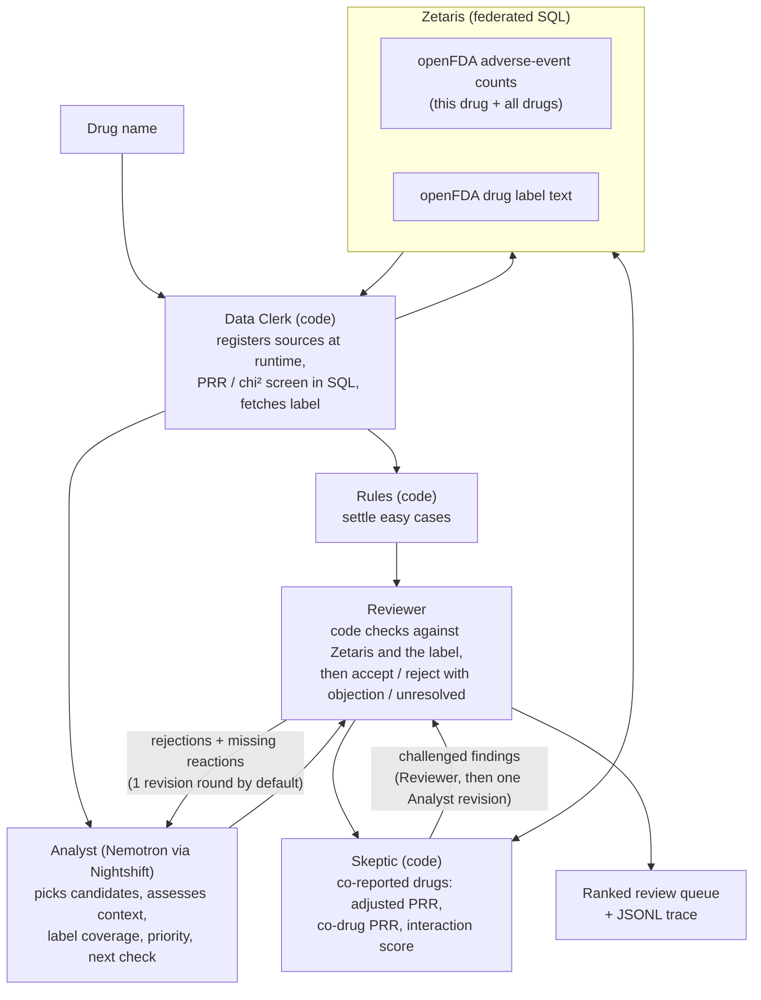

# Vigil: Drug Reaction Review

**AI agents that decide which reported drug reactions deserve a closer look, and explain why.**

Open Agent Hackathon 2026 · **Track 02: The Agent That Can Explain Why** · built on Zetaris, Meterless Nightshift and NVIDIA Nemotron

Vigil helps drug-safety analysts decide which reported drug-reaction patterns deserve a closer look. Every recommendation carries the numbers that triggered it, the label text it was checked against, the strongest objection to it, and a concrete next check.

> FAERS data shows reporting patterns, not that a drug causes an event. Vigil supports expert review; it is not medical advice.

---

## Run it

```bash
git clone https://github.com/realRickyNguyen/Vigil-Agent.git
```

```bash
cd Vigil-Agent
```

Needs Python 3.11+. The app uses only the standard library; `requirements.txt` adds pytest for the tests.

### 1. A quick look with no setup (sample mode)

Three live runs (montelukast, isotretinoin, metformin, 26 Oct) were recorded: every Zetaris query result and every Nemotron reply each run received is in [samples/](samples/). Sample mode replays them through the same pipeline, so without Zetaris or Nightshift you still see a real run, its agents' disagreements and its dossier. It needs no `.env` and no network.

```bash
SAMPLE_MODE=true python -I run.py --drug montelukast
```

Or with Docker, as an API:

```bash
docker build -t vigil .
```

```bash
docker run --rm -p 8000:8000 -e SAMPLE_MODE=true vigil
```

```bash
curl -X POST http://localhost:8000/run -H "Content-Type: application/json" -d @input_examples/example_1.json
```

- The three sample inputs are [input_examples/example_1.json](input_examples/example_1.json) to `example_3.json` (montelukast, isotretinoin, metformin). Their recorded outputs are in [output_examples/](output_examples/).
- A replay takes about 5 s and gives the recorded run's queue, rounds and counts (checked by `tests/test_sample_mode.py`). Checked again on 27 Oct from a fresh clone, in a container with `--network none` and no `.env`.
- It is labelled: every trace event carries `"sample_mode": true`, the console prefixes `[SAMPLE]`, and the dossier and the API response name the recorded run. Run IDs, times and timings are the replay's own. A replay keeps its own World Model (`logs/sample-world-model.json`), so a second replay of a drug shows its verdicts as unchanged.
- `POST /run` can also ask for it per request with `"options": {"sample_mode": true}`. Any other drug returns `NoSampleRecording` with the list of drugs that can be replayed; a new drug needs a live run.

### 2. Tests (no services needed)

```bash
python -m pip install -r requirements.txt
```

```bash
python -I -m pytest tests -q
```

The Meterless World Model engine's own tests are `tests/test_world_model.py` and `tests/test_world_model_reads.py` (see [Sponsor technology](#sponsor-technology)).

### 3. A live run

A live run needs Zetaris and Meterless Nightshift running on your own machine, set up as in the organisers' Participant Setup Guide (Resource Center on HackOS).

1. **Zetaris.** Start the platform (`docker compose up -d` in the platform bundle), then create an API key in the Zetaris web interface (Management › API Tokens).
2. **Nightshift.** Put your NVIDIA key into Nightshift (Setup › Providers), never into `.env`. Vigil was tested on Windows with Nightshift 1.2.1 and 1.2.7. Nightshift 1.2.1 ignores the model an app asks for and routes each call by its own settings (not yet checked on 1.2.7), so leave it only the model Vigil uses:
   - one lane running `nvidia/nemotron-3-ultra-550b-a55b`, with every other lane stopped
   - Setup › Preferences › race width 1
   - Setup › Preferences › Quality track: answer fusion, answer judging, best-of-N, the quality race and the reasoning scaffold all off. Leave the cloud first-token limit at 45 s and NVIDIA thinking at default. Then restart Nightshift, and check the lanes again, because a restart can bring stopped lanes back.

   The 1.2.7 settings page can show its own defaults (race width 6, the Quality track options on auto) instead of the saved settings, so set these values by hand once. Without these settings, calls can go to other models, and about half are answered unstreamed and cut off at 45 s. Each run checks this and warns, in the console and in the dossier's `nightshift_warnings`, when a call was served by another model or with the scaffold on.
3. **Settings.** Copy the example file:

   ```bash
   cp .env.example .env
   ```

   Fill in `ZETARIS_API_KEY`, and the Nightshift Runtime token (shown in the Nightshift Console) as both `METERLESS_RUNTIME_TOKEN` and `MODEL_API_KEY` (the smoke test reads the second). Change `ZETARIS_ORG_ID` and the two service addresses only if yours differ.
4. **Zetaris baseline**, once per Zetaris install:

   ```bash
   python -I scripts/zetaris/run_sql.py scripts/zetaris/openfda_baseline.sql
   ```

5. **Check the connections.** Expect 3 PASS (Zetaris web interface, a Zetaris SQL query, a model reply through Nightshift):

   ```bash
   python -I scripts/smoke_test.py
   ```

6. **Run one drug:**

   ```bash
   python -I run.py --drug montelukast
   ```

   A run takes about 5 to 10 minutes; most of it is Nemotron Ultra's replies. Results: `logs/dossier-<run>.json` (the review queue) and `logs/trace-<run>.jsonl` (every query and model call). Progress lines go to the console.

### As an API

```bash
python -I run.py
```

With no arguments `run.py` starts the API on port 8000 (`PORT` or `--port` to change it). A run takes several minutes and handles one investigation at a time, because parallel runs share the NVIDIA per-minute cap.

```bash
curl -X POST http://localhost:8000/run -H "Content-Type: application/json" -d @input_examples/example_1.json
```

- `POST /run` takes `{"drug": "montelukast"}` or `{"run_id": "demo-001", "input": {"drug": "montelukast"}, "options": {"wait": true}}`. It answers when the run ends with `status`, `output` (summary, accepted review-next items, unresolved items, the full dossier), the agents, the models, `trace_id`, `log_file` and `execution_time_seconds`.
- With `"options": {"wait": false}` it answers `202` at once; `GET /runs/<run_id>` then reports `running` or the finished result.
- Failures come back as `{"status": "error", "error": {"type", "message", "recoverable"}}`: `InvalidInput` (400), `DrugNotFound` (404), `Busy` or `RunIdInUse` (409), `ZetarisUnavailable`, `NightshiftUnavailable` or `NightshiftUnauthorized` (502), `NoSampleRecording` (404, in sample mode for a drug with no recording). The trace records the error too.
- `GET /health` shows the configured models and service addresses (never keys) and whether a run is in progress.

### With Docker

```bash
docker build -t vigil .
```

```bash
docker run --rm -p 8000:8000 --env-file .env -v "$(pwd)/logs:/app/logs" -v "$(pwd)/state:/app/state" vigil
```

Zetaris and Nightshift keep running on the host. Inside the container, `localhost` and `127.0.0.1` in the settings become `host.docker.internal` (set `DOCKER_HOST_REWRITE=false` to turn that off), so the same `.env` works. The `logs/` mount keeps traces and dossiers; the `state/` mount keeps the World Model between runs. Progress lines appear in `docker logs`. The image holds no secrets: `.env` is excluded at build time and read at `docker run`.

To record a new drug for sample mode: `python -I run.py --drug <drug> --record` (with Zetaris and Nightshift running).

## Why this matters

Drug-safety knowledge keeps changing after a medicine is approved, and every new signal has to be weighed by someone.

| | | |
|---|---|---|
| **23%** | **2 million+** | **~27,000 · 99.9%** |
| of 560 novel medicines approved 2001 to 2019 later received an FDA safety action (median follow-up 12 years) | adverse-event and medication-error reports evaluated each year by FDA's drug-safety office | statistical safety alerts in one company's year (GSK, 2023), and the share closed with a documented rationale |
| [Doernberg et al., *JAMA Intern Med* 2026](https://jamanetwork.com/journals/jamainternalmedicine/article-abstract/2842413) | [FDA Office of Surveillance and Epidemiology](https://www.fda.gov/about-fda/cder-offices-and-divisions/cder-office-surveillance-and-epidemiology) | [*Drug Safety* 2026, MLIT study](https://link.springer.com/article/10.1007/s40264-026-01696-0) |

These are three separate pieces of evidence, from different populations and years. They do not form a funnel, and none of them means that a quarter of medicines are unsafe or that the reports are confirmed injuries. Together they show three things:
- safety review after approval has consequential work to do
- the evidence arrives at scale
- generating an alert is the start of the work, not the end. Each one needs a decision, and the reason for it has to be written down.

## The user and the problem

**User:** a drug-safety (pharmacovigilance) analyst doing first-pass review of public reporting patterns, for example at a small biotech or a hospital pharmacy.

**Problem:** the analyst has to decide which reported drug-reaction patterns deserve further investigation, and assemble the evidence that makes each decision defensible. The hard part is the stretch between "this looks suspicious" and "here is a reasoned next step". For every candidate, the analyst asks:

1. **What triggered it?** The report counts and the disproportionality statistics.
2. **What does the label already say?** Whether the existing warnings describe it exactly, describe something broader or narrower, or say nothing.
3. **What weakens the first interpretation?** The drug's own indication, vague terms, data limits, competing explanations.
4. **What should happen next?** Investigate further, keep monitoring, or close it with a stated reason, for a human to decide.

Public data makes this harder, not easier. For montelukast (an asthma drug), the strongest statistical signals in FAERS are asthma, wheezing and airway obstruction: that's the disease the drug treats, not a side effect. Telling those apart from patterns worth a closer look is the judgement Vigil is built to support.

## What goes in, what comes out

**In:** a drug's generic name.

```json
{ "drug": "montelukast" }
```

**Out:** a **review queue** (the dossier), ranked so that "review next" comes first, plus a full trace of how it was produced.

| Every entry carries | Values |
|---|---|
| Report count and PRR, with the SQL that produced them | from Zetaris, re-checked by the Reviewer |
| `context`: what kind of term this is | clinical event · treated condition · non-clinical |
| `label_coverage`: does the current label already describe it? | covered · not found · unclear · not assessed |
| `label_quote`: the label sentence | extracted by code, never written by the model |
| `review_priority` | review next · insufficient evidence · lower priority |
| `strongest_objection` | the Reviewer's best argument against the finding as it stands |
| `next_check` | one concrete check that would settle or advance it |
| `workflow_status`: did the review finish, and how? | reviewed · unresolved · not reviewed · pending · failed |
| `history` | each round's claim, verdict and objection |
| `label_search`, where the label names the reaction | every fetched section searched in code before any model call, with which sections can support coverage |
| `uncertainty`, how thin the evidence is | expected count, PRR 95% interval, IC025 and a thin-evidence mark, worked out in code |
| `report_sources` (review-next entries only) | country and reporter-type flags against the drug's usual mix, as context, never a reason to reject |
| `reporting_cluster` (review-next entries only) | "check the reporting cluster first" when 80% or more of the reports come from one country (50 or more points above the drug's usual share) or half or more from lawyers, with the reason. Display only: the priority and the order don't change |
| `since_last_run` | this verdict against the World Model's verdict from earlier runs: new, unchanged, changed or not settled now, with the changed fields and why |
| `manual_review`, whether a person should look first | a flag with its reasons, which changes no status, priority or ranking |

The dossier also reports **coverage**: how many reactions were screened, passed the statistical screen, were shown to the agents, assessed, reviewed, left unresolved or not reached. "Reviewed" means the Reviewer model accepted the finding, not that a safety professional checked it. The trace (`logs/trace-<run>.jsonl`) records every Zetaris query, every model call (including which model actually answered), and every agent message.

Two parts of the dossier sit outside the queue. `data.scope` names both 999-reaction caps and their cutoffs, so a reader can see what the screen can't reach. The **serious-term safety net** (`safety_net`) lists, for a person to review, EMA's designated medical events, terms outside the screen with more than half of their reports flagged serious, and pregnancy and newborn terms, with no cap. It opens with a summary line. In each section the terms the label search doesn't find by name come first, then those named only outside effect text (such as a contraindication), then those the effect text covers, each by serious reports. Every row has its serious reports and share, its label status, a designated medical event flag and a thin mark under 3 reports. Nothing in the safety net reaches an agent, the queue or its ranking.

## Why this needs agents

The statistics don't need an LLM, and Vigil doesn't use one for them: disproportionality runs as SQL in Zetaris. Easy cases are settled by code rules: administrative terms, a reaction named in the indications, or a reaction named word for word in a warning. The model is used where judgement in language is needed:

- **Matching medical terms to label prose.** FAERS uses standard medical terms (MedDRA); labels use free text. "Nightmare" is covered by "sleep disturbances". "Productive cough" sits under "cough". "Full blood count abnormal" is broader than the label's "thrombocytopenia", so it is not covered. Keyword matching gets these wrong.
- **Telling the disease from the drug.** Wheezing for an asthma drug, or blood glucose for a diabetes drug, reflects the patients' illness. Deciding this needs knowledge of what the drug treats and what that condition looks like.
- **Choosing what deserves attention.** Montelukast alone has 256 reactions that pass the statistical screen. Vigil orders them by reporting strength and label status so an analyst can start at the top. It does not yet weigh seriousness, outcome or vulnerable groups.
- **Arguing with itself.** A single model pass can't challenge its own first reading. Vigil has a second agent whose job is to object, and the first agent has to answer.

Code keeps the agents honest. The Reviewer's checks cannot be overruled by a model:
- the report count and PRR each finding cites are re-queried from Zetaris
- at least one cited query ID must exist
- every claimed label term must actually appear in the label
- "review next" is only allowed for an unlabelled clinical event that comes with a next check

Numbers written into free text, such as the reasoning, are not checked.

## How it works



- **Data Clerk (code):** for any drug name, registers openFDA REST sources as Zetaris tables at runtime, computes the report-based 2×2 table (PRR, chi-squared, Evans screen) in SQL, and fetches the current label.
- **Analyst (Nemotron Ultra via Nightshift):** always assesses the 15 strongest signals by chi-squared and may add up to 5 more of its own choice from the next 15, then assesses each one in its own call. It sees only the label sentences relevant to that reaction, plus the indication and the boxed warning.
- **Reviewer (code, then Nemotron Ultra):** runs the code checks first. It then accepts, rejects with an objection the Analyst must answer, or marks a finding unresolved when the evidence can't settle it. It also names up to 3 unassessed reactions that it expects a reviewer to want to see.
- **Skeptic (code, Zetaris counts):** takes the strongest accepted "review next" findings (top 3 by chi²) and checks them against the drugs most often reported alongside them (top 3, salts merged). For each co-drug it asks whether the reaction is disproportionate for the co-drug itself, whether this drug's PRR stays at 2 or above once the co-drug is adjusted for (Mantel-Haenszel over reports with and without it), and whether reports naming both drugs show more of the reaction than either alone predicts (the Omega interaction measure, Norén et al., *Statistics in Medicine* 2008). A finding is challenged only when the adjusted PRR falls below 2 for some co-drug; the co-drug's own signal and the interaction score are shown as context, because in our test runs neither separated real signals from the patients' shared conditions. A challenged finding goes back to the Reviewer with these numbers; if the Reviewer rejects it, the Analyst gets one revision and the Reviewer a final look. The Skeptic never changes a priority itself.
- **Loop:** one revision round by default (`REVIEWER_ROUNDS`), inside a 10-minute run budget (`RUN_BUDGET_SECONDS`) that skips later steps when time runs out and records what it skipped. Accepted findings are never redone. If the agents go round in circles, or an objection is still standing when the rounds run out, the finding closes as **unresolved** rather than being accepted by default.
- **Resilience:** parallel one-reaction calls, streamed replies, retries and a shared pause on rate limits. Anything that still fails is reported as `failed` or `not_reviewed`, never guessed.

## How Vigil answers Track 02

> *Build agents that investigate complex questions across multiple data sources, connect findings, and produce evidence-backed answers or recommendations.*

| Track 02 asks for | In Vigil |
|---|---|
| **Investigate complex questions** | "Which of this drug's reported patterns deserve a closer look, and why?" There are hundreds of screen-positive reactions, each needing interpretation, not lookup |
| **Across multiple data sources** | Two openFDA datasets, adverse-event counts (this drug and the whole database) and drug labels, joined through Zetaris tables registered at runtime for any drug. Statistics and label prose are combined in one investigation. A third stream, the co-reported drugs on each top finding's reports, is queried through Zetaris for the Skeptic. |
| **Connect findings** | Each finding links its numbers, the matching label sentence, the Reviewer's objection and the Analyst's answer, round by round |
| **Evidence-backed answers or recommendations** | A ranked recommendation (review next / insufficient evidence / lower priority). Every number in the structured fields traces to a query ID and its SQL; every label quote is extracted by code; unresolved disputes are shown, not hidden |
| **Explain why** | `strongest_objection`, `next_check` and `history` say why each item sits where it does, and what would change it |

## Sponsor technology

- **Zetaris.** The data layer and where the statistics are computed. openFDA endpoints are registered as Zetaris REST tables **at runtime for whatever drug is asked about**, cached, flattened into views, and joined in SQL to produce the 2×2 disproportionality table. The Reviewer re-queries Zetaris to verify every number the Analyst cites. Without Zetaris there is no screen and no verification.
- **Meterless Nightshift.** The only model provider. Every agent call goes through Nightshift's OpenAI-compatible gateway with the required headers, and the trace records which model actually served each call. 
- **Meterless World Model engine.** `app/engines/world_model.py` is a Python port of the Meterless World Model reference (Apache-2.0): stable IDs, merge bands, provenance on every write, idempotent ingest, bitemporal edges and an ordered audit log, with the reference's eight conformance checks ported as tests. Vigil adds decisions that record the facts they rest on: each run stores the drug's label version and its settled verdicts, and when a later run sees a new label version, the earlier verdicts are reopened and listed in the dossier for a second look. Every run also reads the World Model back: each dossier item gets `since_last_run`, which compares its verdict with the one the engine holds from earlier runs of the drug (new, unchanged, changed or not settled now, with the fields that changed and why: a new label version, different report counts, or the agents' judgement on the same evidence). The run summary also lists reactions an earlier run sent to review next that this run did not assess, and the trace keeps the engine's audit entries for the run. On real montelukast runs of 25 Oct this showed 19 verdicts unchanged and 3 changed between runs on the same label, which is the run-to-run variation one run per drug cannot otherwise show. The agents' prompts never read the World Model: a past answer shown to the model is read as evidence, which is what Nightshift's H-MEM replay did on 23 and 24 Oct. Each dossier says this under `world_model.read_by`.
  - **Engine test:** `python -I -m pytest tests/test_world_model.py tests/test_world_model_reads.py -q`. The first eight tests in `tests/test_world_model.py` are the reference's conformance checks; the rest cover label versions, reopening and the `since_last_run` read-back. All 20 pass in about 5 s, with no service needed.
- **NVIDIA Nemotron.** Both agents run on `nvidia/nemotron-3-ultra-550b-a55b` through Nightshift.
- **Cursor.** Optional for this hackathon, and the team does not use it. Development is done with Claude Code.

**What is different about our use of them.** Zetaris does more than store the data: it registers openFDA for whatever drug is asked about at runtime, computes the statistics in SQL, and acts as the referee when the Reviewer re-queries it to check every number the Analyst cites. The World Model holds decisions together with the label version they rest on, so a label change reopens them, and code reads it back to show what changed between runs. We keep it out of the agents' prompts on purpose. For the same reason we wall off Nightshift's H-MEM with a fresh scope on every call, after finding that replayed answers anchored the model, and we count injected memories from Nightshift's own receipts to show it stays at zero. Nemotron is used only where judgement in language is needed, and the trace records which model served every call.

## Limitations

- **FAERS** reports are voluntary and unverified, can be duplicated, and show association, not causation. Screen-positive means "worth a look", not new or proven.
- **We count every report that mentions the drug,** including reports where it was not the suspect drug. This broadens the population; it does not necessarily inflate the PRR.
- **Coverage limits:**
  - A reaction is screened only if it is among the 999 most-reported reactions both for all drugs and for this drug (openFDA's limit without a key). On FDA's raw quarterly files these two caps hide 85 to 93% of the five gold drugs' screen-positive reactions, and 36 of EMA's 62 designated medical events (rare, serious terms such as torsade de pointes) are outside the all-drugs list.
  - A reaction needs at least 3 reports with the drug to pass the screen. Most passes with 3 to 20 reports fail a stricter shrinkage test (EB05 of 2 or more).
  - The Analyst assesses a limited number of candidates per run.
  - The coverage counts show how many reactions were screened and assessed. The dossier's `data.scope` names both caps and their cutoffs, and the safety net lists the serious and pregnancy terms they hide, for a person to review.
- **Aggregate data only:** no case-level review and no duplicate removal. Breakdowns such as reporter type give context, not adjustment for confounding.
- **Co-reported drugs:** the Skeptic adjusts for one co-drug at a time, and only for the top co-drugs of the top findings. Adjusting for all co-drugs together needs case-level data. The most frequent co-drug is often just the usual companion treatment, and a rarer co-drug can be the one that matters. The Omega score flags combinations to review; it does not show a pharmacological interaction, and interactions among three or more drugs are not assessed.
- **Label search:** code finds a reaction's name, a few set synonyms and simple changes ("reduces body weight" for WEIGHT DECREASED), not a broader term. Empagliflozin's label covers EUGLYCAEMIC DIABETIC KETOACIDOSIS under a ketoacidosis warning that never says euglycaemic, so the search doesn't find it, and the dossier says a broader term may still cover what it doesn't find.
- **Labels:** the app takes the newest single-ingredient prescription label openFDA has for the generic name (from the 10 newest). Generic labels of the same drug can differ, and the chosen one is named in the dossier.
- **Combination products:** both search fields include products that combine the drug with others (about 1% of atorvastatin's reports, 7% of metformin's, 47% of acetaminophen's). The dossier records the share, and above 5% the agents are told a reaction may belong to the partner drug.
- **Nightshift memory:** Nightshift's H-MEM adds earlier answers to a prompt after the app sends it, and the model treated them as vetted, which repeated one wrong answer across runs. The app keeps it out by sending a fresh `meterless-scope` on every call, because Nightshift walls its memory by scope. The World Model is the app's memory of past decisions instead. Each model call's trace event records how many memories were injected (from Nightshift's own receipt), and the dossier counts them under `model_calls`, so a run shows it was none.
- **Shared model:** the Analyst and Reviewer use the same model, so their agreement is not independent corroboration. The code checks are the independent part.

## Data and privacy

All data is public: openFDA adverse-event aggregates and drug labels. No case-level or personal data reaches the app or the model. Secrets live only in `.env`, which is gitignored.

## More

Named **Black Box** until 23 Oct 2026, with agents called Clerk, Hunter and Judge (now Data Clerk, Analyst and Reviewer). Traces and evaluation reports from before the rename keep the old names.


- [docs/HANDOFF.md](docs/HANDOFF.md): current state, code map, next steps
- [docs/ideas/VIGIL.md](docs/ideas/VIGIL.md): design and the reasons behind it
- [docs/TEAM_SETUP.md](docs/TEAM_SETUP.md): notes for the team's own development machines, including run-speed troubleshooting
- [docs/CLINICAL_RELIABILITY.md](docs/CLINICAL_RELIABILITY.md): label search, evidence marks and the safety net
- [docs/ZETARIS_USL.md](docs/ZETARIS_USL.md): a Zetaris Unified Semantic Layer over the same sources plus NLM RxNav, built separately on 27 Oct (the app does not read it)
- [AGENTS.md](AGENTS.md): rules for coding agents
- [eval/](eval/): gold set, labelling rules, scorer, reports
- [docs/PREEXISTING.md](docs/PREEXISTING.md): pre-existing work declaration

## Licence

Apache License 2.0 ([LICENSE](LICENSE)). The World Model engine is a port of the Meterless reference engine, also Apache-2.0; see [NOTICE](NOTICE).
